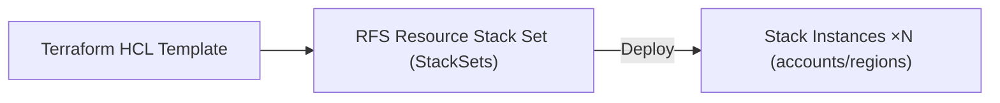

# Huawei Cloud RFS Resource Stack Set Deployment Practice (Cross-Account / Cross-Region)

[](LICENSE)
[](https://www.huaweicloud.com)
[](https://www.terraform.io)


> Built on Huawei Cloud **RFS (Resource Formation Service)** native **Resource Stack Set (StackSets)** capability, enabling cross-account, cross-region batch template deployment with concurrency control.

## 1. Overview

This repository provides a reusable Huawei Cloud best practice: declare an RFS Resource Stack Set through Terraform + the `huaweicloud` Provider, and concurrently and reliably deploy the same template (Terraform HCL) to multiple target accounts and regions, with concurrency policies, failure tolerance, and exponential backoff retries. It is suitable for teams that need to deliver infrastructure uniformly across multi-account / multi-region environments.

## 2. Table of Contents

- [1. Overview](#1-overview)
- [2. Table of Contents](#2-table-of-contents)
- [3. Architecture Diagram](#3-architecture-diagram)
- [4. Highlights](#4-highlights)
- [5. Cloud Services Involved](#5-cloud-services-involved)
- [6. Prerequisites](#6-prerequisites)
- [7. Quick Start](#7-quick-start)
- [8. Step-by-Step Deployment](#8-step-by-step-deployment)
- [9. Usage and Verification](#9-usage-and-verification)
- [10. Cleanup Resources](#10-cleanup-resources)
- [11. Detailed Description](#11-detailed-description)
- [12. Dependencies](#12-dependencies)
- [13. FAQ](#13-faq)
- [14. Contribution Guidelines](#14-contribution-guidelines)
- [15. License](#15-license)
- [16. Contact](#16-contact)

## 3. Architecture Diagram



Core capabilities:
- `huaweicloud_rfs_stack_set` defines the stack set (template and permission model);
- `null_resource` supplements stack instances (`CreateStackInstance`), working with `huaweicloud_rfs_stack_set_deployment` for one-click deployment;
- `operation_preferences` controls concurrency and failure tolerance (`RegionConcurrencyType` / `MaxConcurrentCount` / `FailureToleranceCount`);
- `managed_operation.enable_parallel_operation` provides native parallel deployment capability.

## 4. Highlights

- **Native Resource Stack Set**: Huawei Cloud RFS natively provides the StackSets capability.
- **One-Click Deployment**: Fully declared in Terraform; a single `terraform apply` completes "stack set → instances → target resources".
- **Reliable Concurrency**: Native parallel deployment + conflict retry + status polling, with no self-built scheduler required.
- **Self-Contained Demo**: `self_deploy = true` automatically discovers the current account and creates the management/managed agencies.

## 5. Cloud Services Involved

| Service | Purpose | Remarks |
|---|---|---|
| RFS (Resource Formation Service) | Resource Stack Set (StackSets) | huaweicloud_rfs_stack_set |
| RFS Deployment | Deploy template to instances | huaweicloud_rfs_stack_set_deployment |
| IAM Agency | Management/Managed Agency | Required for SELF_MANAGED mode |
| Terraform HCL Template | Stack template content | Declares required_providers |

> **Tip**: All services can be created with one click via the Terraform in this repository. For cleanup, see [Section 10 "Cleanup Resources"](#10-cleanup-resources).

## 6. Prerequisites

- A Huawei Cloud account (default region `cn-north-4`, North China-Beijing4) with RFS and target account/region deployment permissions.
- Locally installed `terraform >= 1.5`, `huaweicloud` provider `>= 1.70.0`.
- Credentials: Obtain the Access Key and Secret Access Key from the Huawei Cloud "My Credentials" page and pass them to the deployment script (e.g. `terraform.tfvars` or environment variables). **Do not** write credentials into any code or configuration file.

## 7. Quick Start

```bash
cd infra
cp terraform.tfvars.example terraform.tfvars
# Edit terraform.tfvars: stack_set_name / target accounts / regions / template

terraform init -upgrade
terraform plan
terraform apply
```

Key points:
- `permission_model = "SELF_MANAGED"` requires the management agency to include the `iam:tokens:assume` permission (required for RFS to assume the managed agency). `self_deploy` automatically creates two agencies, but this permission usually needs to be granted in the console by an account with **Security Administrator** (select the system role **Agent Operator** or a custom policy).
- The template must be Terraform HCL: declare `required_providers { huaweicloud = { source = "huawei.com/provider/huaweicloud" } }`, and **must not write a `provider` block**.
- `stack_set_vars` / `deployment_vars_overrides` (`vars_body`) must be in HCL `.tfvars` format (e.g. `vpc_cidr = "192.168.0.0/16"`).

## 8. Step-by-Step Deployment

1. **Copy the variable example**: `cp infra/terraform.tfvars.example infra/terraform.tfvars`, then fill in `stack_set_name` / target accounts / regions / template.
2. **Initialize**: `cd infra && terraform init -upgrade` (downloads the huaweicloud provider).
3. **Preview**: `terraform plan`, verify the stack set and deployment resource manifest.
4. **Execute**: `terraform apply`, create the resource stack set and deployment instances; self-deploy mode automatically creates two IAM agencies.
5. **Verify**: See the end-to-end verification steps in [Section 9](#9-usage-and-verification).

## 9. Usage and Verification

- Console RFS → Resource Stack Set: confirm `stack_set_name` is created with status "Normal".
- Console RFS → Stack Instance: confirm instances appear under the target account/region with status `CURRENT`.
- `terraform output stack_set_id` / `stack_set_name` / `stack_set_status` to retrieve deployment info.
- Verify in the target account/region console that the resources actually created by the template (e.g. sample VPC / Subnet / Security Group) are provisioned.

> **Strongly recommended**: After deployment, please verify by following the steps in this section and confirm that the business functionality is available before considering the delivery complete.

## 10. Cleanup Resources

```bash
cd infra
terraform destroy
```

> When `self_deploy = true`, the two self-built IAM agencies are automatically destroyed; in `SERVICE_MANAGED` mode, you also need to clean up the Organization Unit associations in the console.

## 11. Detailed Description

- Architecture and capability description: `docs/architecture.md`
- Deployment guide (prerequisites / step-by-step / FAQ): `docs/deployment-guide.md`

## 12. Dependencies

Main dependencies:
- Huawei Cloud Terraform Provider (`huaweicloud`)
- Huawei Cloud RFS (Resource Formation Service)
- Huawei Cloud Python SDK (`huaweicloudsdkcore` / `huaweicloudsdkrfs`, for stack instance lifecycle management)

## 13. FAQ

- **How to choose `permission_model`?** For single-account demos, choose `SELF_MANAGED`; for cross-account organizational management, choose `SERVICE_MANAGED`, and pre-complete the Organization Unit authorization in the console.
- **`stack_set_vars` error?** RFS requires `.tfvars` HCL format (e.g. `vpc_cidr = "192.168.0.0/16"`), not YAML/JSON.
- **Relationship between Resource Stack Set and Stack Instance?** The stack set is the template definition; the instance is the resource stack that deploys the template to a specific account/region.

## 14. Contribution Guidelines

Please submit feedback and improvement suggestions via Issue; direct PRs are not accepted for this repository — changes are merged by the maintainer after review.

## 15. License

This practice is released under the MIT No Attribution license. See [LICENSE](LICENSE).

## 16. Contact

| Role | Info |
|---|---|
| **Creator** | [@<dgc-git>](https://github.com/dgc-git) |
| **Maintainer** | [@<dgc-git>](https://github.com/dgc-git) |
| **Submitter** | [@<dgc-git>](https://github.com/dgc-git) |
| Communication channel | Submit feedback and improvement suggestions via repository Issue
