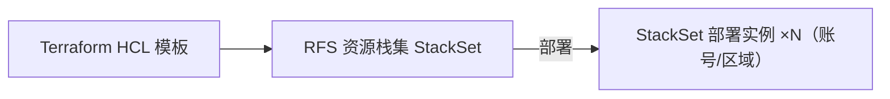

# 华为云 RFS 资源栈集部署实践（跨账号 / 跨区域）

[](LICENSE)
[](https://www.huaweicloud.com)
[](https://www.terraform.io)


> 基于华为云 **RFS（资源编排服务）** 原生「资源栈集（StackSets）」能力，实现跨账号、跨区域的模板批量部署与并发控制。

## 1. 简介

本仓库提供一套可复用的华为云最佳实践：通过 Terraform + `huaweicloud` Provider 声明 RFS 资源栈集，将同一套模板（Terraform HCL）并发、可靠地部署到多个目标账号与区域，支持并发策略、失败容忍与指数退避重试。适用于需要在多账号 / 多区域环境中统一交付基础设施的团队。

## 2. 目录

- [1. 简介](#1-简介)
- [2. 目录](#2-目录)
- [3. 架构图](#3-架构图)
- [4. 方案亮点](#4-方案亮点)
- [5. 涉及云服务](#5-涉及云服务)
- [6. 前置条件](#6-前置条件)
- [7. 快速开始](#7-快速开始)
- [8. 分步部署](#8-分步部署)
- [9. 使用方法与验证](#9-使用方法与验证)
- [10. 清理资源](#10-清理资源)
- [11. 详细说明](#11-详细说明)
- [12. 依赖](#12-依赖)
- [13. FAQ](#13-faq)
- [14. 贡献指南](#14-贡献指南)
- [15. 许可证](#15-许可证)
- [16. 联系方式](#16-联系方式)

## 3. 架构图



核心能力：
- `huaweicloud_rfs_stack_set` 定义栈集（模板与权限模型）；
- `null_resource` 补建栈集实例（`CreateStackInstance`），配合 `huaweicloud_rfs_stack_set_deployment` 完成一键部署；
- `operation_preferences` 控制并发与失败容忍（`RegionConcurrencyType` / `MaxConcurrentCount` / `FailureToleranceCount`）；
- `managed_operation.enable_parallel_operation` 提供原生并行部署能力。

## 4. 方案亮点

- **原生资源栈集**：华为云 RFS 原生提供 StackSets 能力。
- **一键部署**：Terraform 全量声明，`terraform apply` 即完成「栈集 → 实例 → 目标资源」。
- **并发可靠**：原生并行部署 + 冲突重试 + 状态轮询，无需自建调度。
- **自包含演示**：`self_deploy = true` 自动发现当前账号并创建管理/被管理委托。

## 5. 涉及云服务

| 服务 | 用途 | 备注 |
|---|---|---|
| RFS（资源编排服务） | 资源栈集（StackSets） | huaweicloud_rfs_stack_set |
| RFS 部署 | 模板部署到实例 | huaweicloud_rfs_stack_set_deployment |
| IAM 委托 | 管理/被管理委托 | SELF_MANAGED 模式需要 |
| Terraform HCL 模板 | 栈模板内容 | 声明 required_providers |

> **提示**：所有服务均可通过本仓库的 Terraform 一键创建；如需清理，请参见 [第 10 节「清理资源」](#10-清理资源)。

## 6. 前置条件

- 华为云账号（默认区域 `cn-north-4`），具备 RFS 与目标账号/区域的部署权限。
- 本地安装 `terraform >= 1.5`，`huaweicloud` provider `>= 1.70.0`。
- 在华为云「我的凭证」页面获取 Access Key（AK）与 Secret Access Key（SK），填入部署脚本。**不要**将凭据写入任何代码或配置文件。

## 7. 快速开始

```bash
cd infra
cp terraform.tfvars.example terraform.tfvars
# 编辑 terraform.tfvars：stack_set_name / 目标账号 / 区域 / 模板

terraform init -upgrade
terraform plan
terraform apply
```

要点：
- `permission_model = "SELF_MANAGED"` 需管理委托含 `iam:tokens:assume` 权限（RFS 代入被管理委托所需），`self_deploy` 会自动创建两个委托，但该权限通常需具备 **Security Administrator** 的账号在控制台授予（勾选系统角色 **Agent Operator** 或自定义策略）。
- 模板必须是 Terraform HCL：声明 `required_providers { huaweicloud = { source = "huawei.com/provider/huaweicloud" } }`，且**不能写 `provider` 块**。
- `stack_set_vars` / `deployment_vars_overrides`（`vars_body`）必须是 HCL 的 `.tfvars` 格式（如 `vpc_cidr = "192.168.0.0/16"`）。

## 8. 分步部署

1. **复制变量示例**：`cp infra/terraform.tfvars.example infra/terraform.tfvars`，填入 `stack_set_name` / 目标账号 / 区域 / 模板。
2. **初始化**：`cd infra && terraform init -upgrade`（下载 huaweicloud provider）。
3. **预览**：`terraform plan`，核对栈集与部署资源清单。
4. **执行**：`terraform apply`，创建资源栈集与部署实例；自部署模式会自动创建两个 IAM 委托。
5. **验证**：参见 [第 9 节](#9-使用方法与验证) 的端到端验证步骤。

## 9. 使用方法与验证

- 控制台 RFS → 资源栈集：确认 `stack_set_name` 已创建且状态为「正常」。
- 控制台 RFS → 资源栈实例：确认目标账号/区域下出现实例且状态为 `CURRENT`。
- `terraform output stack_set_id` / `stack_set_name` / `stack_set_status` 取回部署信息。
- 在目标账号/区域控制台核对模板实际创建的资源（如示例 VPC / 子网 / 安全组）已落地。

> **强烈建议**：部署完成后请按本节步骤自行验证，确认业务功能可用，方可视为交付完成。

## 10. 清理资源

```bash
cd infra
terraform destroy
```

> `self_deploy = true` 时会自动销毁自建的两个 IAM 委托；`SERVICE_MANAGED` 模式下还需在控制台清理组织单元关联。

## 11. 详细说明

- 架构与能力说明：`docs/architecture.md`
- 部署指导（前置 / 分步 / FAQ）：`docs/deployment-guide.md`

## 12. 依赖

主要依赖：
- 华为云 Terraform Provider（`huaweicloud`）
- 华为云 RFS 服务（资源编排服务）
- 华为云 Python SDK（`huaweicloudsdkcore` / `huaweicloudsdkrfs`，用于栈集实例生命周期管理）

## 13. FAQ

- **`permission_model` 如何选？** 单账号演示选 `SELF_MANAGED`；跨账号组织化管理选 `SERVICE_MANAGED`，并在控制台预先完成组织单元授权。
- **`stack_set_vars` 报错？**RFS 要求 `.tfvars` HCL 格式（如 `vpc_cidr = "192.168.0.0/16"`），不是 YAML/JSON。
- **资源栈集与资源栈实例的关系？** 栈集是模板定义；实例是把模板落到具体账号/区域下的资源栈。

## 14. 贡献指南

请通过 Issue 提交反馈与改进建议；本仓库不接受直接 PR，统一由维护者评审后合入。

## 15. 许可证

本实践以 MIT No Attribution 许可证发布。详见 [LICENSE](LICENSE)。

## 16. 联系方式

| 角色 | 信息 |
|---|---|
| **创建者** | [@<dgc-git>](https://github.com/dgc-git) |
| **维护者** | [@<dgc-git>](https://github.com/dgc-git) |
| **提交者** | [@<dgc-git>](https://github.com/dgc-git) |
| 交流渠道 | 通过仓库 Issue 提交反馈与改进建议
