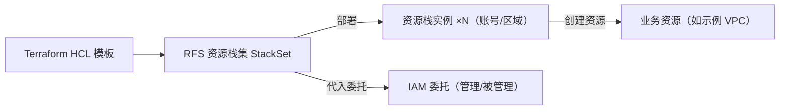

# 架构说明：华为云 RFS 资源栈集（StackSets）跨账号 / 跨区域批量部署

> 本实践以华为云 RFS（资源编排服务）原生「资源栈集（StackSets）」能力，实现同一套 Terraform HCL 模板批量、并发地部署到多个目标账号与区域，并通过「并发策略 + 失败容忍 + 指数退避重试 + 状态轮询」保证部署稳定性。

## 1. 核心能力

- **资源栈集定义**：`huaweicloud_rfs_stack_set` 声明模板与权限模型（SELF_MANAGED / SERVICE_MANAGED）。
- **资源栈集部署**：`huaweicloud_rfs_stack_set_deployment` 把模板部署到已存在的实例。
- **实例补建 / 删除**：`null_resource` + 本地签名脚本（`infra/scripts/rfs_stack_instances.py`）补建实例，使 `terraform apply` 真正落地资源；`terraform destroy` 一并清理。
- **并发与失败容忍**：`operation_preferences` 控制并发（`region_concurrency_type` / `max_concurrent_count` / `failure_tolerance_count`）；`managed_operation.enable_parallel_operation` 启用原生并行部署。
- **稳定化重试**：签名脚本对「操作进行中」冲突按指数退避重试；轮询 `ShowStackSetOperation` 直到终态。

## 2. 架构图

| 节点 | 角色 |
|---|---|
| RFS 资源栈集 StackSet | 集中声明模板、变量、并发策略 |
| 资源栈实例 ×N | 把模板实际落到目标账号/区域 |
| Terraform HCL 模板 | 业务资源（如示例 VPC）的最终定义 |
| IAM 委托 | SELF_MANAGED 模式下 RFS 代入目标账号部署资源所需的双委托链 |

## 3. 关键流程

### 3.1 资源栈集创建（RFS API）

1. 声明 `huaweicloud_rfs_stack_set.this`：传入 `stack_set_name` / `permission_model` / `template_body|template_uri` / `vars_body`。
2. `managed_operation.enable_parallel_operation` 启用原生并发部署。
3. SELF_MANAGED 模式下，挂接管理委托（administration_agency）与被管理委托（managed_agency）。

### 3.2 实例补建（签名脚本）

`huaweicloud_rfs_stack_set_deployment` 仅部署已存在的实例；provider 1.96.x 无 `stack_set_instance` 资源。本实践用 `null_resource` + 本地签名脚本在 `terraform apply` 阶段调用 RFS `CreateStackInstance`，在 `destroy` 阶段调用 `DeleteStackInstance`，补齐这一缺口。

### 3.3 模板部署

`huaweicloud_rfs_stack_set_deployment.this` 把模板以 `template_body|template_uri` 形式部署到目标账号/区域，支持 `deployment_targets.regions` / `domain_ids` / `organizational_unit_ids` 与 `operation_preferences` 全部字段。

### 3.4 操作稳定化

签名脚本对「操作进行中」冲突（409 / 429）按指数退避重试；通过 `ShowStackSetOperation` 轮询直到终态（SUCCEEDED / FAILED / STOPPED 等），超时 24h。

## 4. 权限模型

| 模型 | 说明 | 适用场景 |
|---|---|---|
| SELF_MANAGED | 管理账号显式指定 `administration_agency` 与 `managed_agency` | 单账号 / 已知目标账号列表 |
| SERVICE_MANAGED | 通过组织单元（OU）授权部署 | 多账号组织化管理 |

`permission_model = "SELF_MANAGED"` 时需要管理委托含 `iam:tokens:assume`（RFS 代入被管理委托所需）；该权限为全局级，需具备 **Security Administrator** 的账号在控制台授予（可勾选系统角色 **Agent Operator** 或新建自定义策略）。详见 README 第 7 节「SELF_MANAGED 前置权限」。

## 5. 并发与失败容忍

| 字段 | 含义 |
|---|---|
| `region_concurrency_type` | `SEQUENTIAL`（按 `region_order` 顺序）/ `PARALLEL`（并发） |
| `max_concurrent_count` | 并发部署的区域上限（RFS 上限 5） |
| `max_concurrent_percentage` | 并发部署的区域百分比 |
| `failure_tolerance_count` | 允许失败的区域数 |
| `failure_tolerance_percentage` | 允许失败的区域百分比 |
| `failure_tolerance_mode` | 严格（遇错即停）/ 宽松（按容忍值继续） |

## 6. 失败容忍模式

| 模式 | 行为 |
|---|---|
| STRICT_FAILURE_TOLERANCE | 任一实例失败立即停止整个部署 |
| SOFT_FAILURE_TOLERANCE | 失败实例数 ≤ tolerance 时整体仍视为成功 |

## 7. 涉及云服务

| 服务 | 用途 |
|---|---|
| RFS（资源编排服务） | 资源栈集（StackSets） |
| IAM 委托 | SELF_MANAGED 模式的权限链 |

## 8. 参考

- 华为云 RFS 资源栈集 API：`POST /v1/stack-sets/{stack_set_name}/stack-instances`
- 华为云 RFS 操作轮询：`GET /v1/stack-sets/{stack_set_name}/operations/{operation_id}`
- 资源栈集稳定化、并发策略、失败容忍的官方约束以华为云 RFS 当前版本为准。
